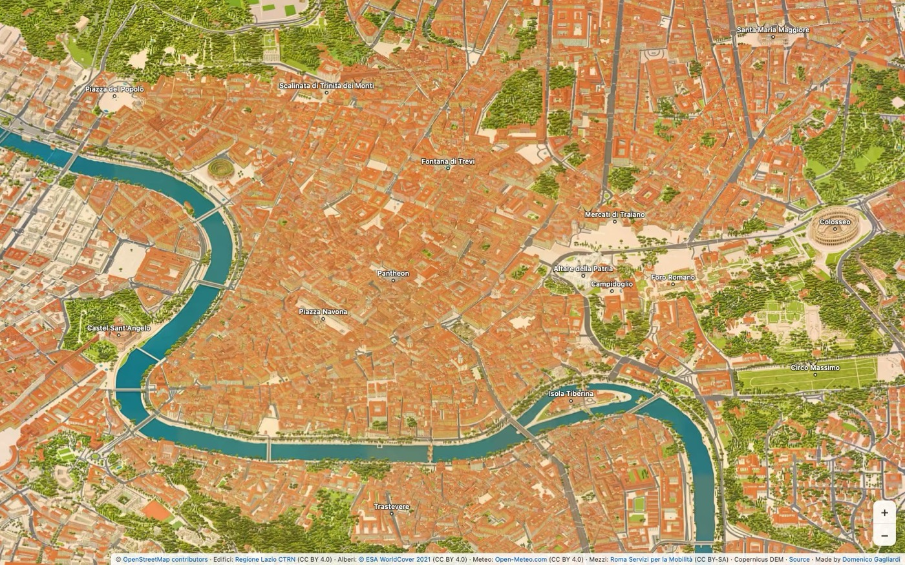
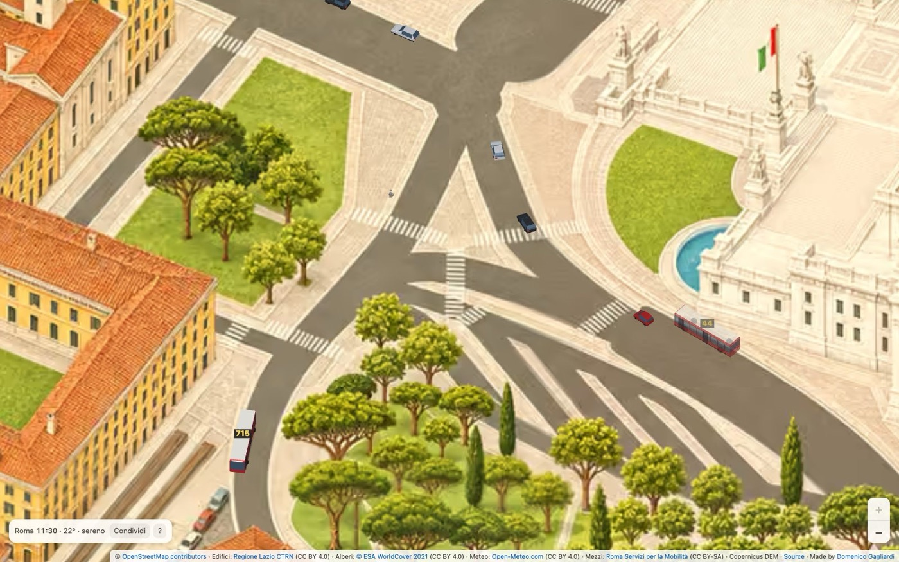
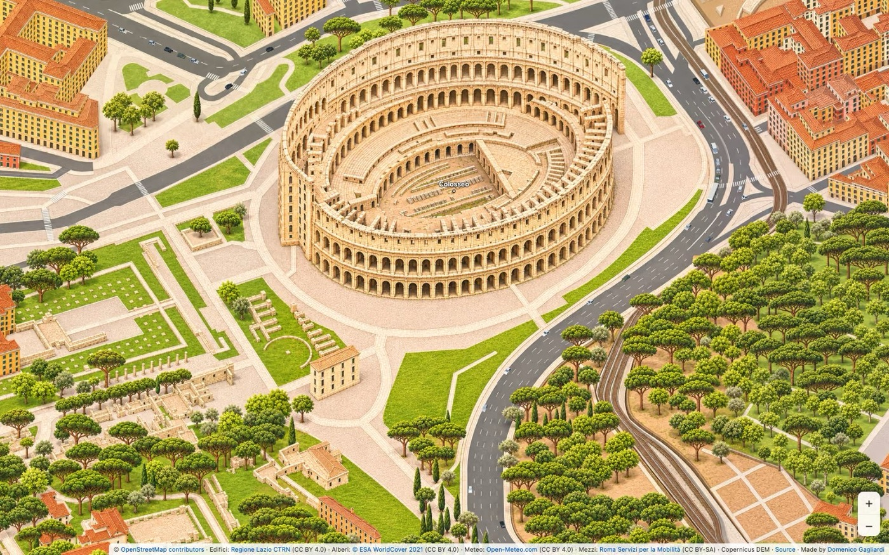
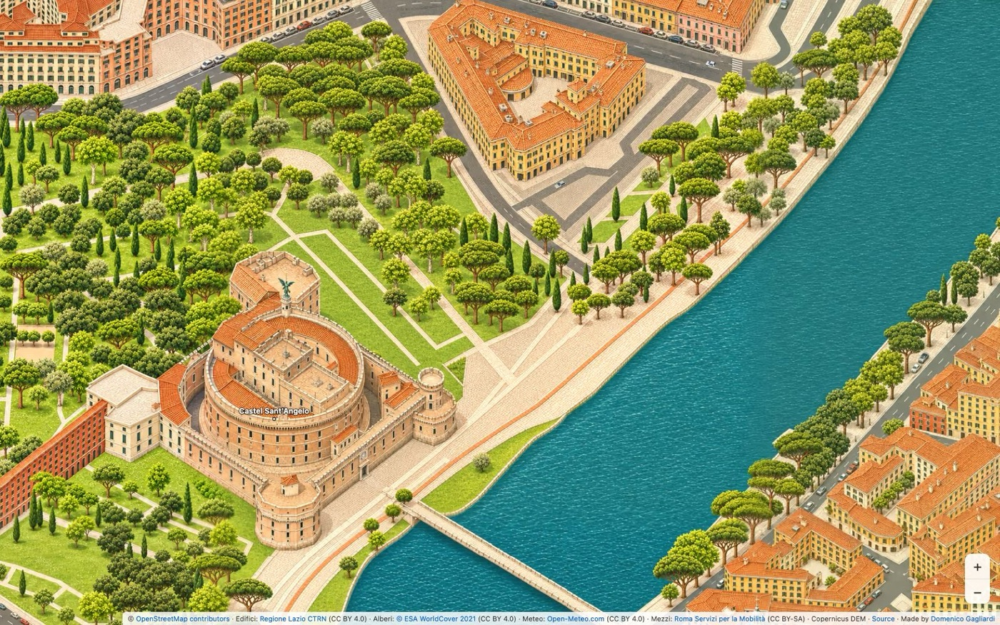
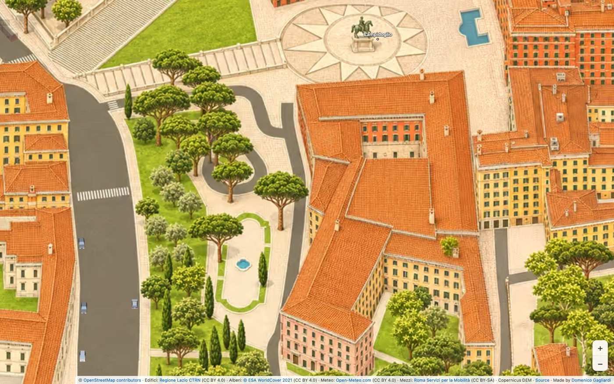
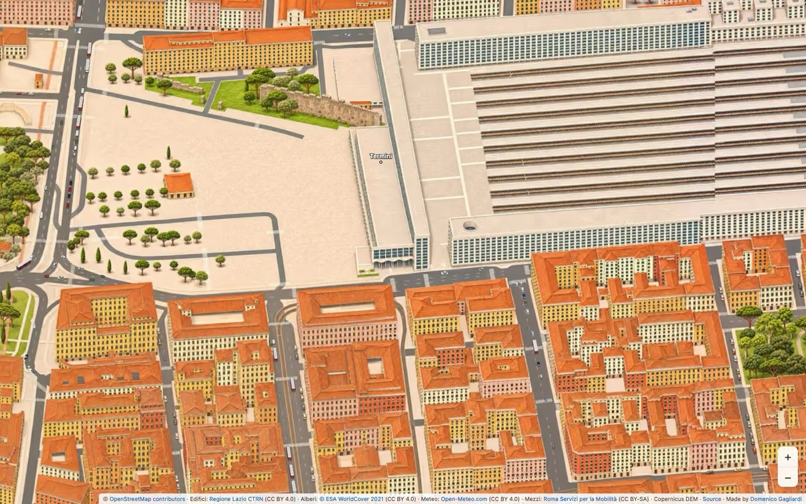
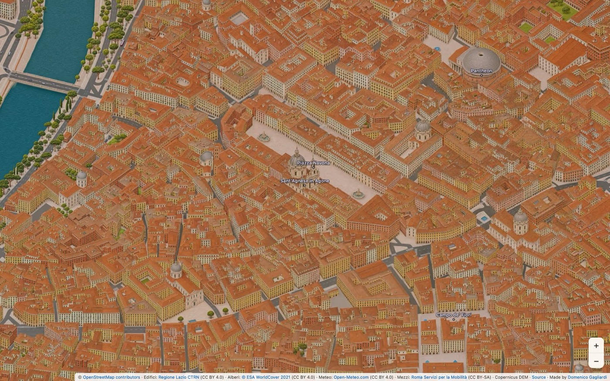
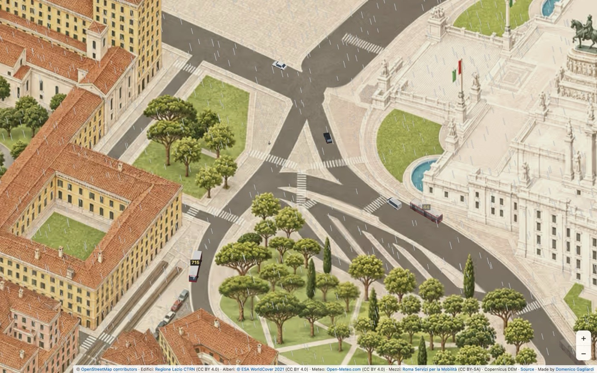
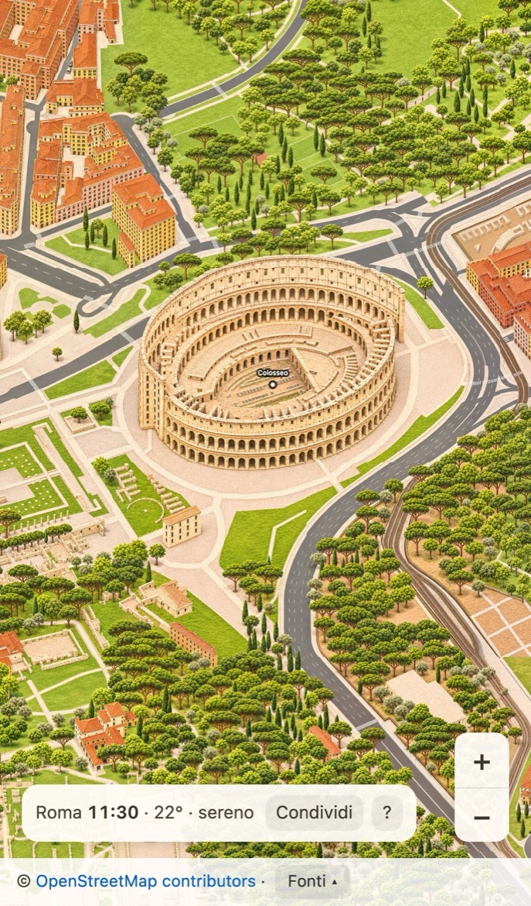

# Mondo Isometrico

**Roma come non l'hai mai vista: una mappa isometrica dipinta, viva, da esplorare dall'alto fino ai sampietrini.**

### → [mondoisometrico.domenicogagliardi.com](https://mondoisometrico.domenicogagliardi.com)

Mondo Isometrico è una mappa di Roma in prospettiva isometrica, come una grande illustrazione da
sfogliare. Ogni palazzo, strada, albero e monumento è al suo posto vero, ricostruito da dati aperti
(OpenStreetMap, la Carta Tecnica della Regione Lazio, i rilievi del terreno di Copernicus) e poi
dipinto, tessera dopo tessera, con l'intelligenza artificiale.

Si parte dalla città intera e si scende fino al dettaglio: le arcate del Colosseo, le statue
dell'Altare della Patria, le strisce pedonali, le singole auto.

## Una città che si muove

- **Traffico sulle strade vere.** Auto, taxi e furgoni girano sulla rete stradale di OpenStreetMap,
  rispettano i sensi unici, si fermano agli incroci e prima delle strisce pedonali.
- **Bus e tram delle linee reali.** I bus ATAC seguono i percorsi veri, con il numero di linea sul
  tetto, e i tram corrono sui loro binari; di notte girano le linee notturne.
- **L'ora e il meteo di Roma, adesso.** La luce segue il sole sopra Roma minuto per minuto, dal mattino
  all'ora dorata alla notte; se a Roma piove, sulla mappa piove, con l'intensità vera.
- **Cantieri al confine.** Dove la pittura non è ancora arrivata, piccole squadre di pittori stendono
  la vernice tra coni e transenne: la mappa cresce a ogni aggiornamento.

## I monumenti, come sono davvero

| | |
|---|---|
|  |  |
| **Colosseo** | **Castel Sant'Angelo** |
|  |  |
| **Campidoglio**, con la Cordonata e la piazza di Michelangelo | **Termini** |

Ogni monumento è controllato contro OpenStreetMap e Wikidata: scalinate della loro larghezza vera,
piazze con il loro disegno, nessun edificio inventato o spostato.

## Di giorno, di sera, sotto la pioggia

| | |
|---|---|
|  |  |
| **La sera** | **Quando piove a Roma** |

## Anche in tasca

Funziona sul telefono come sul computer: si trascina, si allarga con due dita, si condivide la vista
esatta con un tocco. E se qualcosa non torna o hai un'idea, c'è il pulsante **Segnala un problema o
un'idea** direttamente sulla mappa.

---

**Fonti dei dati:** © OpenStreetMap contributors (ODbL), Regione Lazio CTRN (CC BY 4.0), ESA WorldCover
2021 (CC BY 4.0), Copernicus DEM, Roma Servizi per la Mobilità (CC BY-SA), Open-Meteo (CC BY 4.0).
Dettagli e obblighi di licenza in [ATTRIBUTION.md](ATTRIBUTION.md). Mappa dipinta con l'AI.

Codice: [MIT](LICENSE) · Immagini della mappa: CC BY 4.0 · Note tecniche: [docs/sviluppo.md](docs/sviluppo.md)

Basato su [Isometric World](https://github.com/krasun/isometricworld) di Dmytro Krasun ·
Realizzato da [Domenico Gagliardi](https://domenicogagliardi.com)
