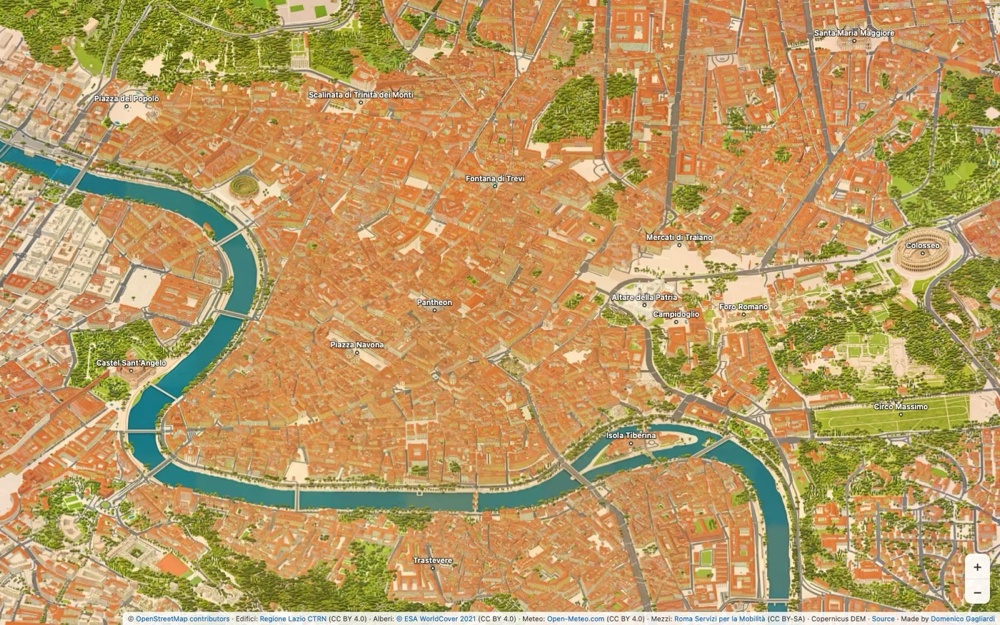
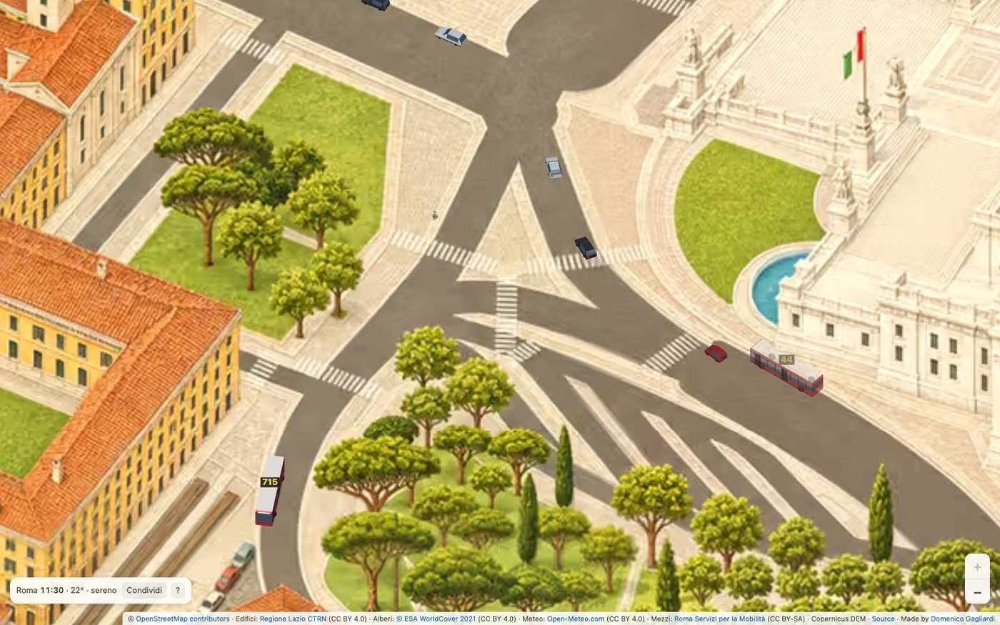
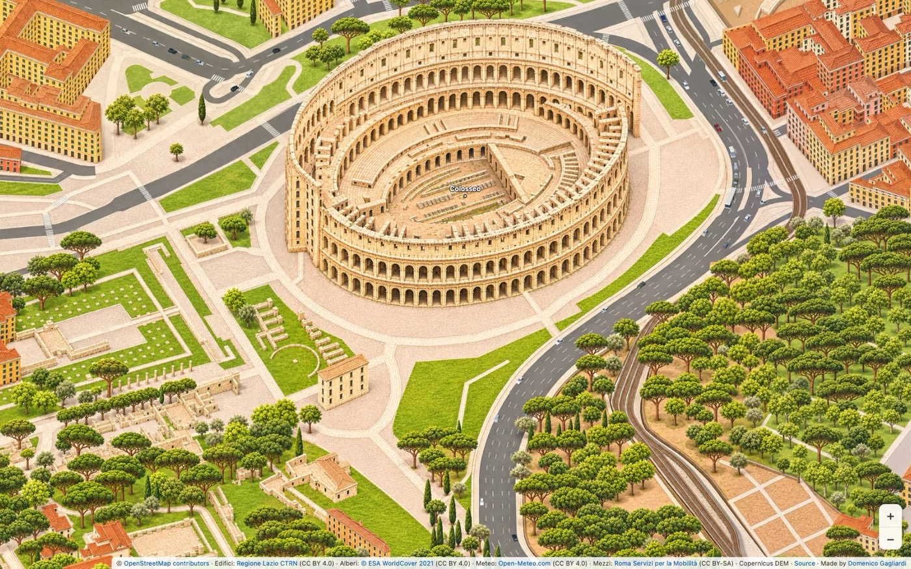
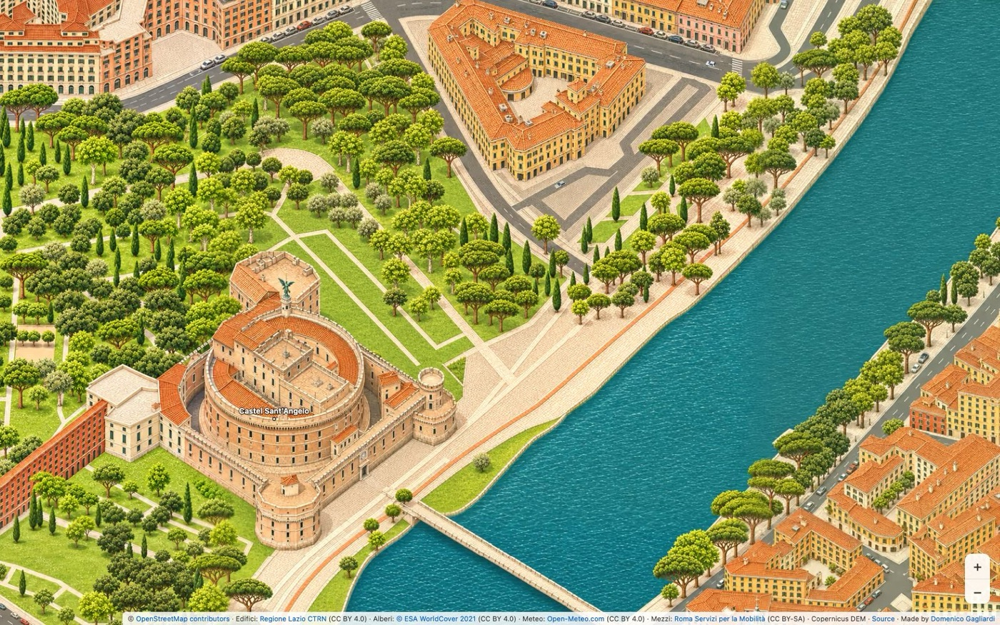
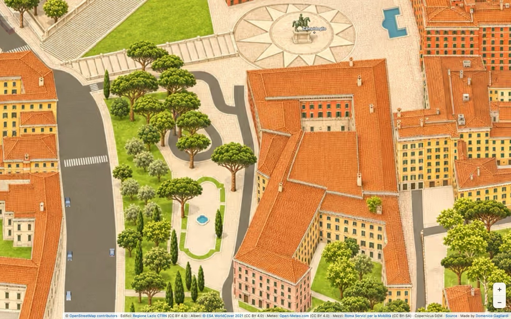
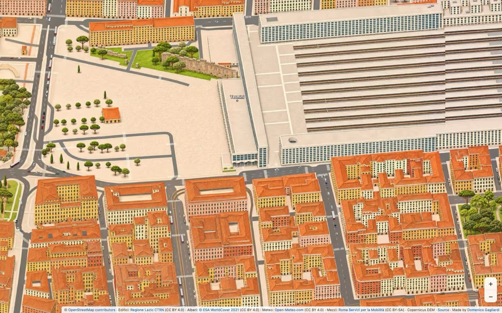
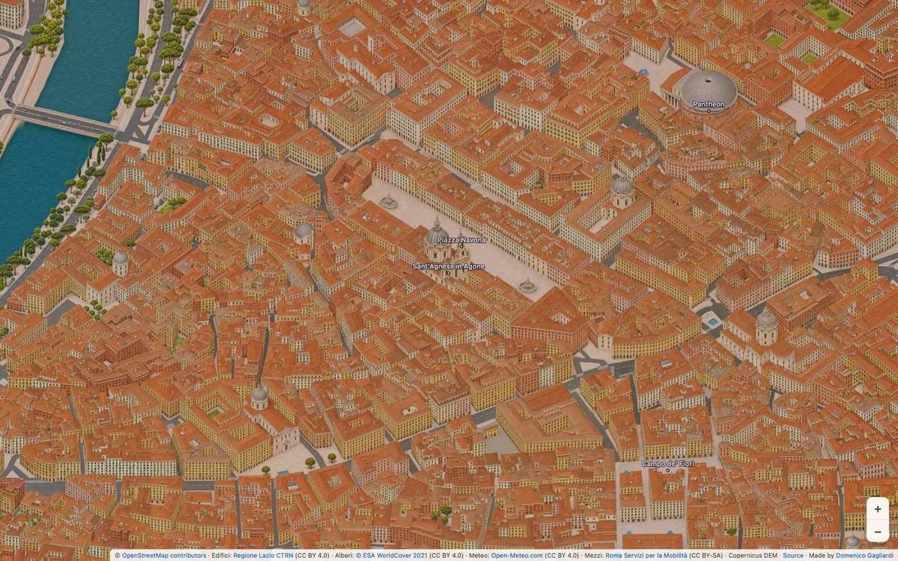
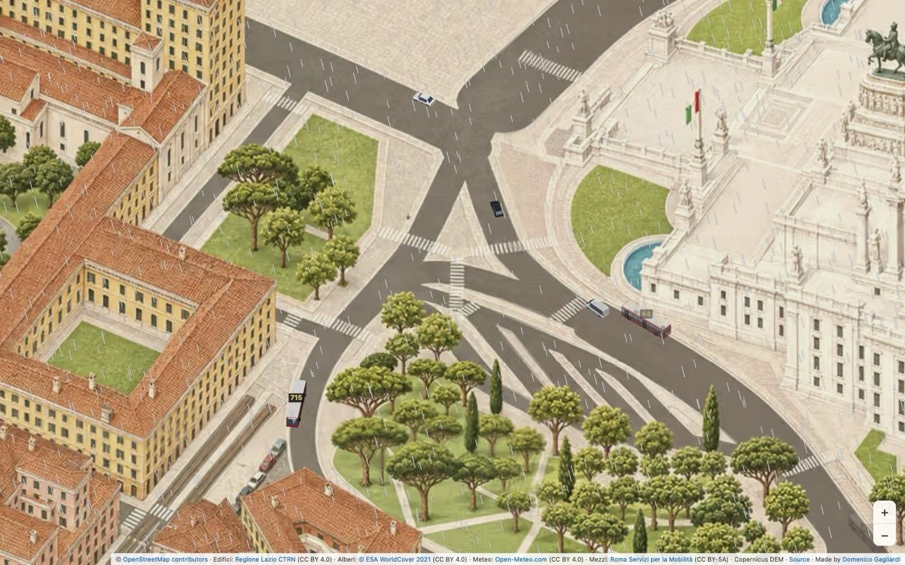
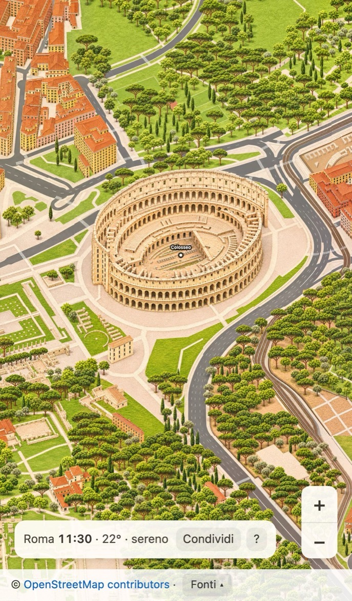

# Mondo Isometrico

Mappa isometrica di Roma costruita da dati aperti e dipinta con l'AI.

Sito: [mondoisometrico.domenicogagliardi.com](https://mondoisometrico.domenicogagliardi.com)

Edifici, strade, alberi e monumenti sono ricostruiti da OpenStreetMap, dalla Carta Tecnica della
Regione Lazio e dal modello del terreno di Copernicus. Le tessere della mappa sono poi dipinte con
un modello di AI. Si può zoomare dalla città intera fino ai singoli edifici.

## Cosa si muove sulla mappa

- Le auto circolano sulla rete stradale di OpenStreetMap, rispettano i sensi unici e si fermano agli
  incroci e alle strisce pedonali.
- I bus ATAC seguono i percorsi delle linee reali e mostrano il numero di linea; i tram corrono sui
  binari. Di notte girano le linee notturne.
- La luce segue l'ora e la posizione del sole a Roma. Se a Roma piove, piove anche sulla mappa,
  con l'intensità registrata da Open-Meteo.
- Nelle zone non ancora dipinte ci sono dei cantieri: la mappa si allarga a ogni aggiornamento.

## Monumenti

| | |
|---|---|
|  |  |
| Colosseo | Castel Sant'Angelo |
|  |  |
| Campidoglio | Termini |

Posizione e forma dei monumenti sono confrontate con OpenStreetMap e Wikidata.

## Sera e pioggia

| | |
|---|---|
|  |  |
| Sera | Pioggia |

## Da telefono

La mappa funziona anche da telefono: si sposta trascinando, si zooma con due dita e si può
condividere il link alla vista corrente. Per segnalare un problema o proporre un'idea c'è il
pulsante "Segnala un problema o un'idea" sulla mappa.

---

Fonti dei dati: © OpenStreetMap contributors (ODbL), Regione Lazio CTRN (CC BY 4.0), ESA WorldCover
2021 (CC BY 4.0), Copernicus DEM, Roma Servizi per la Mobilità (CC BY-SA), Open-Meteo (CC BY 4.0).
Dettagli e obblighi di licenza in [ATTRIBUTION.md](ATTRIBUTION.md).

Codice: [MIT](LICENSE). Immagini della mappa: CC BY 4.0. Note tecniche: [docs/sviluppo.md](docs/sviluppo.md).

Basato su [Isometric World](https://github.com/krasun/isometricworld) di Dmytro Krasun.
Realizzato da [Domenico Gagliardi](https://domenicogagliardi.com).
